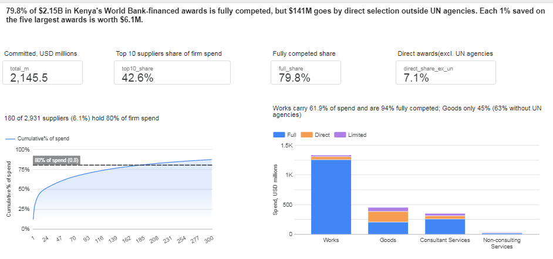
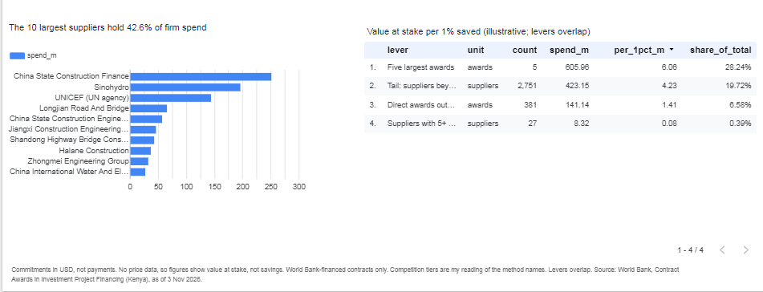

# Kenya Procurement Spend Analysis

**Question:** How concentrated is Kenya's World Bank-financed contract spend among suppliers and categories, and how much of it is competed?

**Tools:** Python (pandas), SQL (SQLite), Looker Studio

## Summary
Where does Kenya's World Bank-financed contract spend go, how concentrated is it, and how much is competed? 4,839 supplier awards worth $2.15B, contracts signed 2019-07-03 to 2026-10-15.

I cleaned the data in pandas (supplier names merged by a written map, individual consultants set aside), queried it in SQL, and measured concentration, competition tiers and local share. Firm spend excludes individual consultants; UN agencies are included.

Spend is concentrated: 180 of 2,931 suppliers hold 80% of firm spend and the top 10 hold 42.6%. Without UN agencies, 196 of 2,928 suppliers hold 80% of firm spend and the top 10 hold 39.9%. Works are 61.9% of spend and 94% fully competed; Goods are 45% fully competed (63% without UN agencies). Limited-competition awards are 3,374 contracts (70%) but only 6.6% of value.

Kenya-registered suppliers receive 48.5% of value (52.1% without UN agencies), but only 37.2% of Works; all five of the largest awards went to suppliers registered outside Kenya.

## Decisions this supports
Decision 1, direct awards: the implementing agency's procurement unit should ask for the justification of each of the 381 direct awards outside UN agencies ($141M, 7.1% of non-UN spend) and test whether the next similar purchase can be competed. Each 1% saved is worth $1.4M. Check first: whether each was single-source for a valid reason, such as an emergency.

Decision 2, repeat small awards: the implementing agency's procurement unit should ask whether a framework agreement fits the 27 suppliers with five or more limited-competition awards ($8.3M, 0.4% of total value). Each 1% saved is worth $0.08M, so this is a small lever and a cheap one to test. Check first: the item, the unit price and the dates of those awards.

Decision 3, the five largest awards: the implementing agency's contract managers should put the five largest awards, 28.2% of total value, under the closest contract management. Each 1% is worth $6.1M. 4 of the 5 were competed through Request for Bids and 1 was direct selection, so the lever is contract management, not the award. Check first: amendments, variations and payment against commitment, which this dataset does not hold.

Decision 4, the long tail: the implementing agency's procurement unit should look at lot packaging and bidding effort for the 2,751 suppliers beyond the 80% line, because 81% of them won only one award ($423M, 19.7% of total value). Each 1% saved is worth $4.2M. Check first: what these one-off purchases are and whether similar ones could be grouped into fewer, larger lots or a framework agreement. The data has no item-level detail, so it cannot show whether they are genuinely different needs.

## Dashboard

Built in Looker Studio. Screenshots shown; the live version is not public.

## SQL
All queries are in [sql/queries.sql](sql/queries.sql). In the tables below, spend is in USD and the percentage columns are shares of total value. Key results:

**Spend by category**

| category                |    n |         spend |   pct |
|:------------------------|-----:|--------------:|------:|
| Works                   |  777 | 1,327,031,376 |  61.9 |
| Goods                   | 2576 |   447,169,748 |  20.8 |
| Consultant Services     | 1301 |   346,006,907 |  16.1 |
| Non-consulting Services |  185 |    25,250,596 |   1.2 |

**Competition by category (% of value)**

| category                |   any_comp_pct |   full_comp_pct |
|:------------------------|---------------:|----------------:|
| Works                   |           96.1 |            94.1 |
| Consultant Services     |           84.6 |            72.4 |
| Non-consulting Services |           65.8 |            53.2 |
| Goods                   |           60.2 |            44.6 |

**Local share by category (% of value)**

| category                |   local_pct |   unknown_pct |
|:------------------------|------------:|--------------:|
| Non-consulting Services |        96.3 |           0   |
| Consultant Services     |        73.7 |           0.5 |
| Goods                   |        59.7 |           2.3 |
| Works                   |        37.2 |           0   |

**Suppliers needed for 80% of firm spend**

|   n_for_80 |   n_suppliers |
|-----------:|--------------:|
|        180 |          2931 |

## Cleaning log
1. Raw kept untouched; worked on a copy. 4,839 rows, 21 columns, total value USD 2,145,458,626.
2. Duplicates: 0 duplicate rows and 0 duplicate contract-and-supplier pairs. 4,711 distinct contract numbers, so a contract with several suppliers spans several rows (one row = one supplier's share).
3. Missing values: Project Global Practice 163, Contract Description 5, Supplier 1, Supplier Country 21, Review type 3. Decision: kept. The missing supplier became "UNKNOWN"; the 21 rows with no country (USD 11.7M) are reported separately; the 3 missing review types became "Unknown".
4. Amounts: median 27,847, 99th percentile 5.47M, 99.9th percentile 58.8M, maximum 172.3M. 1 zero amount (the row with no supplier, flagged zero_amt) and 0 negative amounts.
5. Five largest contracts, all looking real: Sinohydro 172.3M, China State Construction Finance 146.5M and 104.9M (all Works, Request for Bids), UNICEF 116.3M (Goods, Direct Selection) and Longjian Road and Bridge 66.0M (Works, Request for Bids). Together 28.2% of total value. Decision: kept; a few large contracts dominate, and this is stated in the limits.
6. Whitespace: double spaces in Procurement Method (129 rows), Project Name (64), Supplier (4) and Contract Description (283), and leading or trailing spaces in Contract Description (440) and Borrower Contract Reference Number (5). Procurement Method fixed (spaces collapsed and trimmed); the other columns are not used in the analysis.
7. Method spelling: "Consultant Qualification Selection" was written with a double space between "Qualification" and "Selection" in 129 rows and a single space in 2 rows. Merged into one label, leaving 10 method labels.
8. Competition tiers: direct (Direct Selection, UN Agencies (Direct)); full (Request for Bids, Quality And Cost-Based Selection, Quality Based Selection, Fixed Budget Selection, Least Cost Selection); limited or simplified (Request for Quotations, Consultant Qualification Selection, Individual Consultant Selection). All 4,839 rows mapped. The tiers are my reading of the method names.
9. Dates: Contract Signing Date read as month/day/year with an explicit format, 0 unreadable, 3 Jul 2019 to 15 Oct 2026. Fiscal year derived from the date (July start) matches the file's Fiscal Year in 100% of rows. FY2027 is partial.
10. Individual consultants: 688 rows (14.2% of rows, 1.3% of value) share one placeholder name across 669 supplier IDs. Set aside under the label INDIVIDUAL CONSULTANT, so no personal names appear anywhere.
11. Supplier names: 3,017 names against 3,734 IDs, 47 names with more than one ID. Automatic normalisation (uppercase, punctuation removed, legal suffixes such as LTD and LIMITED stripped) turned 3,018 names (including UNKNOWN) into 2,941 keys. 0 keys were empty after normalising.
12. Merge map written by hand: 14 entries, 22 rows changed (Toyota, CFAO, Alpex, AMPC, ADCC, Glogra, Go Solar, Hello Tractor and China International Water and Electric spellings). Joint ventures, Egerton University units and dealers were not merged. Supplier key = cleaned name + supplier country; individuals use their own label. Final firm keys: 2,932, or 2,931 without the zero-value UNKNOWN row.
13. UNICEF (UN agency, Direct Selection, USD 144.2M, 6.7% of value) stays in the totals and the competition shares. Concentration is also reported without UN agencies (see Summary). Country code 1W covers three UN agencies (UNICEF, UN-Habitat, UNOPS; USD 150.2M, 7.0% of value); all of them are direct selection.
14. Related companies and countries: China State Construction Finance (251.4M) and China State Construction Engineering (57.4M) stay separate keys; together they hold 14.4% of total value. One variant of China International Water and Electric is registered in Kenya (1 row, USD 0.58M) and stays a separate key. With the final map, 180 of 2,931 firms hold 80% of firm spend and the top 10 hold 42.6%.
15. Reconciled: 4,839 rows, total amount unchanged, 379 Prior + 4,457 Post + 3 Unknown review types. Saved awards_clean.parquet and awards_clean.csv in Project3_Procurement.

## Checks and limits
**Checks**
- SQL and pandas agree on the number of suppliers that hold 80% of firm spend (180).
- Fiscal year derived from signing dates matches the file's Fiscal Year in 100% of rows.
- Total amount unchanged after cleaning (USD 2,145,458,626); the dashboard category table adds up to the same total.

**Limits**
- Limit: the data has no prices or baseline costs, so 'value at stake' is what each 1% is worth, not savings achieved. Amounts are commitments, only World Bank-financed contracts are included, the competition tiers are my reading of the method names, and the levers overlap, so they must not be added.
- Supplier country is the place of registration, not necessarily where the supplier operates.
- The file covers World Bank-financed contracts only, so it does not describe all procurement in Kenya. The 379 prior-review contracts hold 70.3% of value; the 4,457 post-review contracts hold 29.7%.
- UN agencies are 7.0% of value and all direct selection; results are shown with and without them.
- Supplier = cleaned name + supplier country; 688 individual-consultant rows (1.3% of value) share one placeholder name and are set aside.

## Files
- notebooks/: cleaning (p3_01), SQL (p3_02) and dashboard tables (p3_03)
- data/awards_clean.csv: the cleaned table, one row per supplier award
- data/dashboard/: the five small tables behind the dashboard
- sql/queries.sql: all SQL queries
- images/: dashboard screenshots

## Data source
World Bank, Contract Awards in Investment Project Financing (finances.worldbank.org), filtered to Borrower Country = Kenya, as of 3 Nov 2026. The raw file is not included; download it from the source.

## How to rerun
Open the notebooks in Google Colab in the order p3_01, p3_02, p3_03, and set the Drive folder path at the top of each. To run only the SQL, load data/awards_clean.csv with pandas.read_csv.
